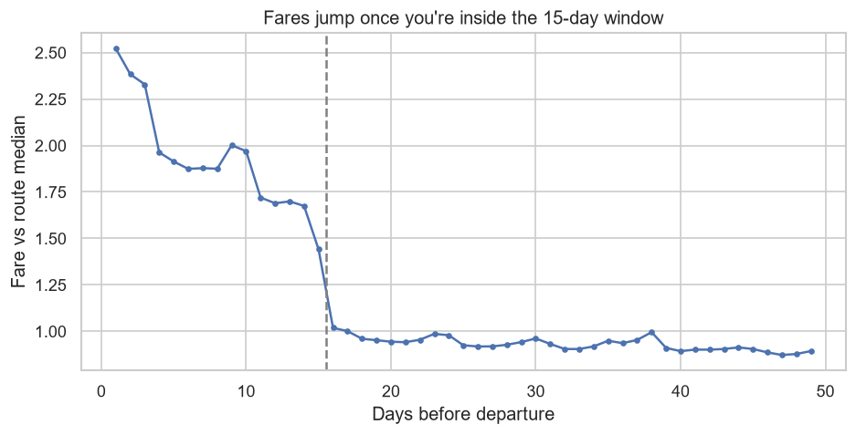
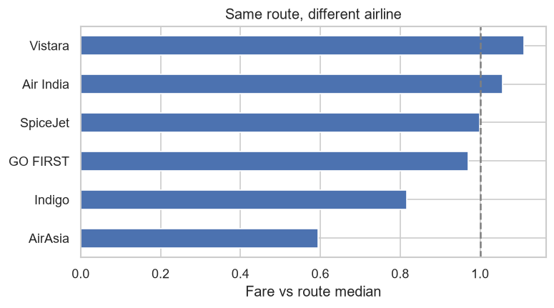

# When should you book a flight in India?

I kept hearing different advice about booking flights: book early, avoid weekends, take the 5am flight. So I took ~300k real fares between India's six biggest metros and checked what actually moves the price.

Data: [Flight Price Prediction](https://www.kaggle.com/datasets/shubhambathwal/flight-price-prediction) on Kaggle, scraped from EaseMyTrip for travel dates between 11 Feb and 31 Mar 2022. It has 206k economy and 93k business fares across Delhi, Mumbai, Bangalore, Kolkata, Hyderabad and Chennai.

## Findings



- Booking 16+ days ahead gets you roughly the normal fare for the route. Inside 15 days, fares jump to ~1.7x, and in the last 3 days to ~2.4x. On a typical route that's about ₹5,500 vs ₹14,000.
- The airline matters almost as much as timing. On the same route, AirAsia is ~40% below the median fare and IndiGo ~18% below, while Vistara is ~11% above.
- Non-stop flights turned out to be cheaper than connecting ones: ~38% below the route median, while 2+ stops are ~44% above. This holds within every airline except AirAsia.
- Weekend flights cost ~5% more, even when booked early (Mann-Whitney U test, p < 0.001).
- Departure time barely matters. Pre-5am flights are ~18% cheaper, but they're under 2% of all flights.
- Business class is ~9x economy on the same airline and route.



## How I did it

I used the raw `economy.csv` and `business.csv` files rather than the cleaned file on Kaggle. The cleaning is at the top of the notebook. The stops column was the messiest part: 37 different values with tabs, newlines and layover airports mixed in, for what is really 0, 1 or 2+ stops. Prices and durations were stored as text, and a few rows were duplicates or had broken durations.

Price levels vary a lot between routes, so most comparisons use each fare divided by the median fare for its route. Because `days_left` and the travel date are tied together in this data, I checked the weekend effect only on flights 16+ days out, where the booking curve is flat.

The full analysis is in [`flight_price_analysis.ipynb`](flight_price_analysis.ipynb), and there is a short write-up in [`flight_fare_report.pdf`](flight_fare_report.pdf).

## Limitations

Each `days_left` value is a different set of flights, not one flight tracked over time, so the booking curve is a cross-section rather than a price history. The data is also from early 2022, and the market has changed since then: Go First stopped flying in 2023 and Vistara merged into Air India in 2024.

## Running it

```
pip install -r requirements.txt
```
Put `economy.csv` and `business.csv` from Kaggle in `data/` and run the notebook.

Tools: Python, Pandas, Matplotlib, Seaborn, SciPy, Jupyter
